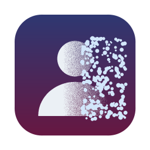

# VanishCam for Mac

Vanish from your webcam in Google Meet, Zoom, WhatsApp Web and other video calls. Make a gesture and you dissolve into the background or disappear in a puff of smoke. Show an open palm and you come back.

Video is processed on your Mac. It is never recorded or sent anywhere.



## How it works

VanishCam reads your real webcam, adds the effect, and sends the result to the **OBS Virtual Camera**, a system-wide webcam that every Mac app can select. A small floating panel and a menu-bar icon let you control it without leaving your call.

## One-time setup

1. **Install OBS Studio 30 or later** from [obsproject.com](https://obsproject.com/download) or with `brew install --cask obs`.
2. **Turn on its virtual camera once.** Open OBS and click **Start Virtual Camera**. When macOS asks, open System Settings > General > Login Items & Extensions and enable **OBS Virtual Camera** under Camera Extensions. Then quit OBS. VanishCam does not need OBS to be running.
3. **Install VanishCam.** Build it (see below) and drag `dist/VanishCam.app` to your Applications folder. The first time, right-click the app and choose **Open**, because it is not signed by an Apple developer.
4. **Allow camera access** when macOS asks.

## Using it in a call

1. Open **VanishCam**. The floating panel and the menu-bar icon appear.
2. Pick **Normal** or **Naruto**, then press **Start**.
3. Step out of the frame for 4 seconds while the background is captured. The panel tells you when to step back in.
4. In Meet, Zoom or WhatsApp Web, choose **OBS Virtual Camera** as your camera. Each app remembers this. While no effect is running, it shows your normal webcam, so you can leave it selected.
5. Make the vanish gesture, or press **Vanish**. Show an open palm ✋, or press **Reappear**, to come back.

The panel floats above your call and never takes focus away from it. Close it any time and reopen it from the menu-bar icon, which has the same controls.

### Effects and gestures

Pick an effect in the panel's **Effect** menu (or under **Effect** in the menu-bar icon).

| Effect | Vanish | Reappear |
|---|---|---|
| **Dissolve** | ✌️ V sign: you dissolve away with a glowing edge | ✋ open palm: you dissolve back in |
| **Dust** | ✌️ V sign: you crumble into particles that blow away | ✋ open palm: the dust flies back together |
| **Teleport** | ✌️ V sign: a shimmering column of light beams you out | ✋ open palm: you beam back in |
| **Glitch** | ✌️ V sign: you break into slices and split colours, then flicker out | ✋ open palm: you glitch back in |
| **Portal** | ✌️ V sign: a glowing ring opens and you spiral into it | ✋ open palm: you spiral back out |
| **Smoke puff** | 🙏 palms together, fingers side by side: you vanish in a puff of smoke | ✋ open palm: you reappear inside the smoke |

Each effect has its own sound, played forwards when you vanish and backwards when you come back. The sounds are generated in code (`packaging/make_sounds.py`); the smoke puff uses the original `assets/vanish.MP3`.

Hold a gesture for about a third of a second. A quick, accidental hand shape does not trigger anything, and there is a short pause after each switch. Sounds play on your speakers.

While you are invisible, the rest of the room stays live: only the area where you are is filled in with the background, which keeps updating as the light changes.

### Tips

- Capture the background with good, steady light. If you move the camera or furniture, press **New background**.
- Other people who walk into the frame while you are invisible are hidden too.
- If the thumbnail shows the wrong camera, choose another under **Webcam** in the menu-bar icon.
- **WhatsApp:** use WhatsApp Web in Chrome (web.whatsapp.com), which supports video calls. The WhatsApp desktop app freezes on the OBS camera because it only accepts the 420v pixel format, which OBS does not provide ([details](https://github.com/kortexa-ai/aicamera/issues/71)). Calls from your phone always use the phone's camera.
- The Naruto sound plays on your speakers, not into the call.
- Your self-view in Meet looks mirrored, as usual. Other people see you the right way round.

## Build the app

Requires macOS 13+ on Apple Silicon and Python 3.12 (`brew install python@3.12`).

```bash
packaging/build_app.sh
open dist/VanishCam.app
```

The script creates `.venv`, installs the dependencies, downloads the MediaPipe models, and builds `dist/VanishCam.app` with everything bundled, so the app works offline.

## Run from source

```bash
python3.12 -m venv .venv
.venv/bin/pip install -r requirements.txt
.venv/bin/python app.py                          # menu-bar app with the floating panel
.venv/bin/python vanish_cam.py --virtual-camera  # engine with a preview window
.venv/bin/python -m unittest test_effects test_hands test_vanish_cam test_video_output
```

`vanish_cam.py` preview keys: `SPACE` new background, `V` vanish, `R` reappear, `F` fullscreen, `Q` quit. Other options: `--mode normal|naruto`, `--camera N`, `--width`, `--height`, `--fps`, `--no-preview --control-stdin` (read commands from stdin) and `--gesture-debug`.

## Credits

Based on [VanishCam by Nicovic17](https://github.com/Nicovic17/vanish_webcam), which created the original effects, gesture recognition and assets. This fork packages it as a macOS app.

Effects are drawn in code (`effects.py`); no anime frames or sprites are included. Gesture and segmentation models are from [Google MediaPipe](https://ai.google.dev/edge/mediapipe).
